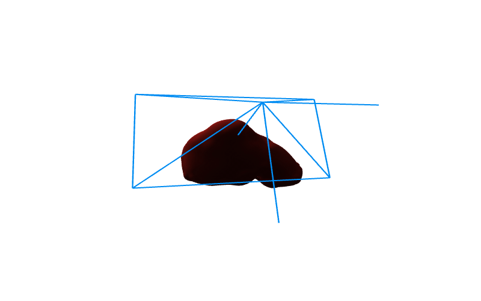
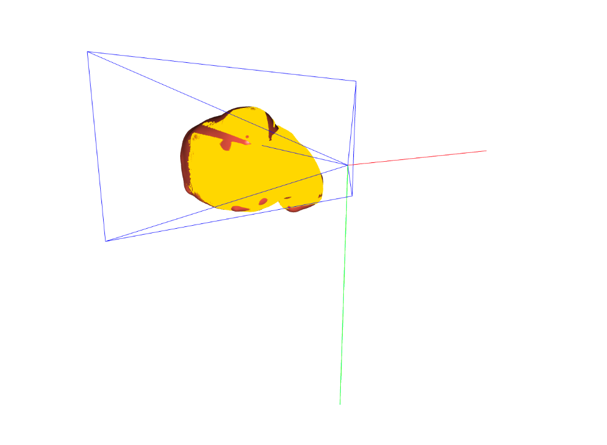
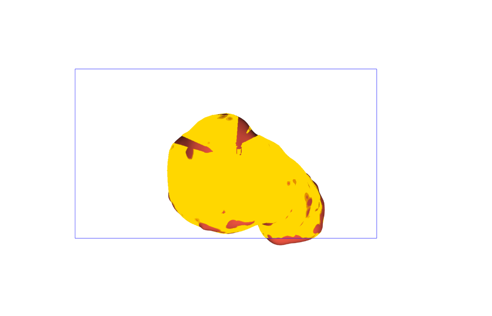
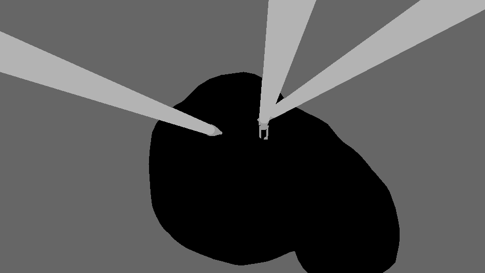
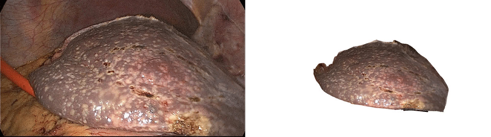

# SURGICAL REGISTRATION CODEBASE

**Purpose:** Discover and visualize the dataset\
*Link to the dataset:* [Kaggle](https://www.kaggle.com/datasets/junezhou001/p2i-lreg?select=Liver_regis)

*Figure 1: Rendered liver with camera viewpoint.*

| 3D View | Aligned Camera View | 2D Label Mask |
| :---: | :---: | :---: |
|  |  |  |

*Figure 2: Overlayed synthetic point cloud and synthetic label image.*

*Figure 3: Real laparoscopic camera view (left) and corresponding rotating 3D surface point cloud (right).*

