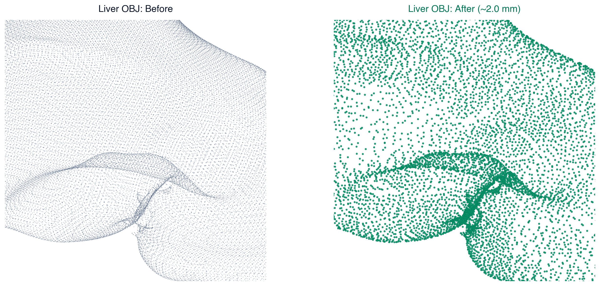
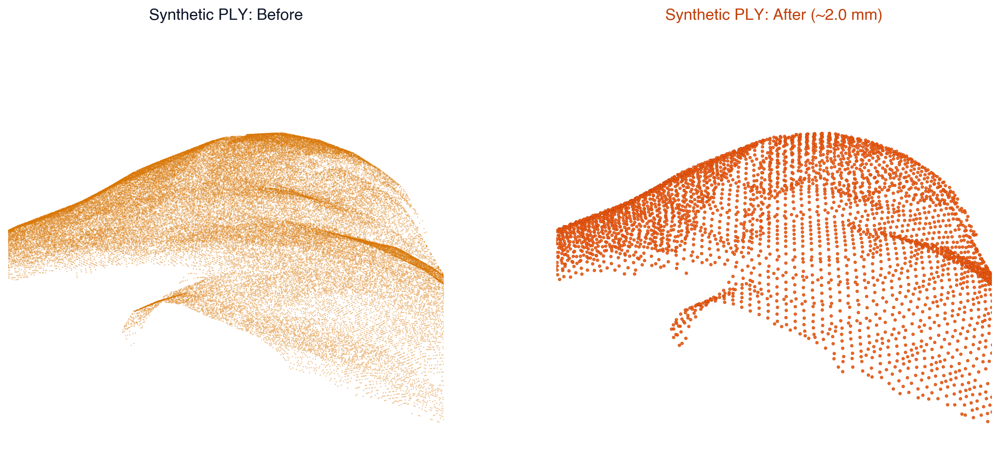
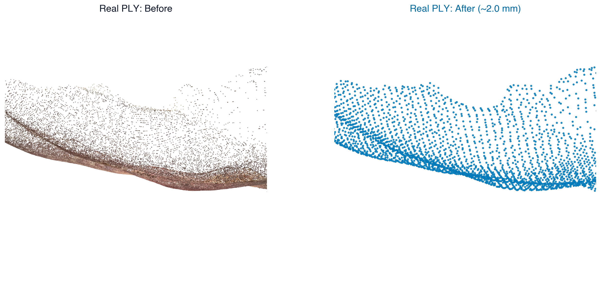

# SURGICAL REGISTRATION CODEBASE

**Purpose:** Discover and visualize the dataset\
*Link to the dataset:* [Kaggle](https://www.kaggle.com/datasets/junezhou001/p2i-lreg?select=Liver_regis)

*Figure 1: Rendered liver with camera viewpoint.*

| 3D View | Aligned Camera View | 2D Label Mask |
| :---: | :---: | :---: |
|  |  |  |

*Figure 2: Overlayed synthetic point cloud and synthetic label image.*

*Figure 3: Real laparoscopic camera view (left) and corresponding rotating 3D surface point cloud (right).*

## Dataset Overview & Key Findings

The **P2I-LReg** (Partial-to-Image Liver Registration) dataset is designed for computer-assisted surgery: aligning a patient's **preoperative 3D CT scan** with **intraoperative laparoscopic video** during liver surgery.

### 1. Data Modalities & Structure

* **Preoperative 3D CT Mesh (`model/`)**:
  * Complete 3D anatomical model of the patient's whole liver (`.obj`).
  * Reconstructed from preoperative CT scans in true metric dimensions

* **Synthetic Data (`syn/`)**:
  * **Simulation Setup:** Rendered in Blender from 2,000 randomized camera viewpoints on a hemisphere around the CT liver.
  * **Ground-Truth Tracking:** Provides calibrated camera intrinsics (`CAM_K.yml`) and exact 6-DoF camera poses (`camPose.yml`).
  * **Simulated Surgical Tools:** 3D CAD models of laparoscopic graspers and hooks are placed in front of the liver, casting occlusions that create realistic tool cutouts in the visible point clouds (`ptsLiverCam*.ply`) and 2D ground-truth masks (`lbl*.png`).

* **Real Clinical Data (`real/`)**:
  * **Live Surgery Video:** Full-HD 1920 x 1080 endoscopic surgery frames (`img.png`).
  * **Unknown Camera Pose:** No tracking sensors exist in the operating room, **estimating this camera pose** is the primary objective of the registration algorithm.
  * **Reconstructed 3D Point Clouds (`liverPcds/`):** 3D surface points generated from monocular video frames using AI depth estimation (*Depth Anything*).
  * **Canonical Scale Factor (`scale/`):** Monocular depth is scale-ambiguous. Principal Component Analysis (PCA) measures the maximum physical spread of the visible liver surface to scale the points into physical millimeters.

### 2. The task

* **Partial-to-Complete Matching:** The laparoscope only observes a partial patch of the front surface, which must be matched against the complete 3D CT organ. 
* **Rigid Pose + Soft-Tissue Deformation:** The algorithm must simultaneously estimate the 6-DoF camera view (rotation and translation) and correct for soft-tissue deformation caused by breathing, surgical tool manipulation, and abdominal gas insufflation.
* $\color{red}\textsf{\textbf{GOAL:}}$ Register the 3D CT object to the estimated cloud point (.ply), taking into consider the deformation of the liver. 

## 3. Preprocessing (~2.0 mm Spacing)

All modalities are standardized to **~2.0 mm** point spacing for consistent geometric matching.

### Liver OBJ
* **Before:** Raw CT mesh in meters (~69k vertices, non-uniform spacing).
* **After:** Scaled to mm (x1000) and decimated by surface area to ~11.5k vertices (~2.0 mm spacing).

*Figure 4: Liver OBJ Before vs After*

---

### Synthetic PLY
* **Before:** Raw simulated point cloud (~135k points, dense and non-uniform).
* **After:** 2.9 mm voxel grid downsampling to ~4.5k points (~2.0 mm spacing).

*Figure 5: Synthetic PLY Before vs After*

---

### Real PLY
* **Before:** Raw depth reconstruction (~1.17M points, 3x4 pixel staircase artifacts).
* **After:** Stride-4 pixel grid subsampling + 3.0 mm voxel filter to ~3.5k clean points (~2.0 mm spacing).

*Figure 6: Real PLY Before vs After*

